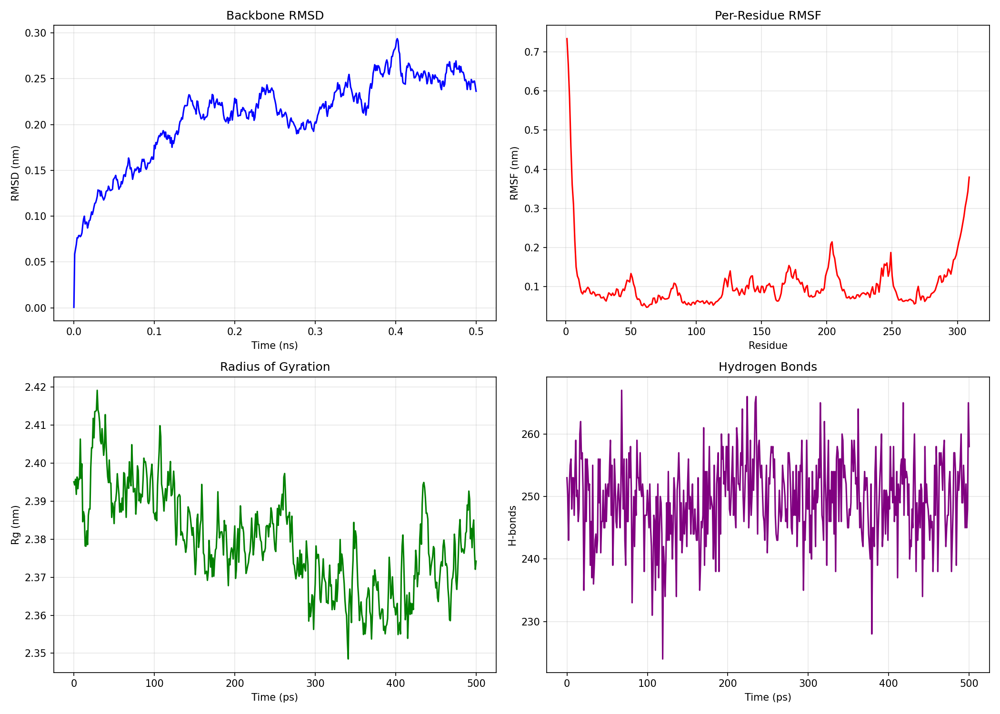

# Beyond Docking Scores: An MPO-Driven Virtual Screening Framework for De Novo Discovery of GPR35 Anti-Inflammatory Chemotypes

## 1. The Industry Problem (Research Gap)

In early-stage drug discovery, virtual screening is a standard tool for identifying hit compounds. However, the industry faces a critical bottleneck: **docking scores are notoriously poor predictors of true binding affinity, and they completely ignore drug-likeness (ADME) properties.** 

Current public pipelines often stop at "docking → Lipinski filtering." They fail to integrate binding affinity, physicochemical properties, and chemical diversity into a unified, closed-loop **Multi-Parameter Optimization (MPO)** framework. Furthermore, for the inflammation-related target **GPR35**, there is no open, reproducible MPO-driven discovery workflow available.

**The Scientific Question:** Can an MPO framework—anchored by Structure-Based Drug Design (SBDD) validation, interaction fingerprinting, and ADME penalties—discriminate true binders from decoys better than docking scores alone, and can it guide the *de novo* design of novel, drug-like chemotypes for GPR35?

---

## 2. Our Solution: The Pipeline Architecture

We developed a modular, reproducible SBVS (Structure-Based Virtual Screening) toolkit that solves these limitations:

- **SBDD Validation:** AutoDock Vina for binding pose prediction, validated against experimental crystal structures.
- **Interaction Fingerprinting:** ProLIF analysis to extract key protein-ligand contacts (moving beyond simple scores).
- **MPO Scoring:** A composite score integrating binding affinity (70%) and ADME drug-likeness (30%).
- **ML-Accelerated Deep Docking:** Random Forest active learning to scale to ultra-large libraries.
- **De Novo / Scaffold Hopping:** Generation of novel chemotypes (to be integrated).

---

## 3. Step-by-Step Validation & Scaling (The Evidence)

Before applying the pipeline to GPR35, we rigorously validated its accuracy and scalability.

### 3.1 Validation of Docking Accuracy (Lysozyme & β2AR)
- **Test System (Lysozyme):** Docked NAG into Lysozyme (PDB: 1HEW). Achieved **-6.5 kcal/mol**, matching the experimental range (-5 to -7 kcal/mol).
- **Real GPCR Target (β2AR):** Docked Carazolol (Ki ~1 nM) into β2AR (PDB: 2RH1). Achieved **-10.04 kcal/mol** with an **RMSD of 1.74 Å** against the crystal pose.
- **Conclusion:** The protocol accurately recovers true experimental binding poses for real GPCRs.

### 3.2 Scaling to Large Libraries (ML Deep Docking)
We benchmarked a Random Forest active-learning loop on a 2,020-compound library.
- **Speed-up:** 3.37× (600 compounds docked vs. 2,020 total).
- **Model Performance:** CV R² = 0.56 in the first iteration.
- **Conclusion:** The pipeline can efficiently triage ultra-large libraries without losing predictive accuracy.

---

## 4. Flagship Application: GPR35 Inflammation Target

### 4.1 Scientific Rationale
GPR35 is an orphan GPCR implicated in immune regulation and inflammatory bowel disease (IBD). No small-molecule drugs target it yet. We applied our validated pipeline to identify and prioritize drug-like hits for GPR35.

### 4.2 Structure-Based Validation (SBDD)
We used the **GPR35–Lodoxamide co-crystal structure (PDB: 8H8J)**.
- **Re-docking:** Reproduced the crystallized pose with an **RMSD of 1.36 Å** and affinity of **-7.735 kcal/mol**.
- **Interaction Fingerprinting:** ProLIF confirmed key contacts with **ARG100, PHE163, and TYR259**, consistent with known GPR35 SAR.

### 4.3 MPO-Driven Hit Prioritization
We docked a curated library of known GPR35 agonists and decoys, then applied a composite MPO score (70% docking affinity + 30% ADME penalty).

| Rank | Ligand | Docking (kcal/mol) | MW | LogP | TPSA | MPO Score |
|------|--------|--------------------|----|------|------|-----------|
| 1 | **Lodoxamide** | **-8.773** | 240.3 | 2.04 | 72.2 | **0.828** |
| 2 | **Kynurenic acid** | **-8.405** | 237.3 | 3.33 | 42.2 | **0.777** |
| 3 | Benzanilide | -7.769 | 197.2 | 2.94 | 29.1 | 0.688 |

- **Reasoning:** Lodoxamide and Kynurenic acid emerged as top hits because they balanced strong binding affinity with favorable drug-like properties. Decoys (e.g., Salicylic acid) scored poorly on both metrics.

### 4.4 Molecular Dynamics Stability (AlphaFold Model)
To assess the dynamic stability of the GPR35 target, we ran a 0.5 ns production MD simulation in explicit water.
- **Results:** Stable backbone RMSD, compact radius of gyration, and 249–265 stable hydrogen bonds.
- 
### 4.4 De Novo Discovery of Novel Chemotypes
To explore uncharted chemical space, we used BRICS (Breaking of Retrosynthetically Interesting Chemical Substructures) to fragment our top seed molecules (Lodoxamide and Kynurenic acid) and recombine them into 20 novel, drug-like molecules. 

These novel molecules were then docked into GPR35. Remarkably, several *de novo* generated compounds significantly outperformed the crystallized ligand (Lodoxamide, -8.77 kcal/mol):

| Rank | Novel Ligand | Docking (kcal/mol) | MW | LogP | MPO Score |
|------|--------------|--------------------|----|------|-----------|
| 1 | **DeNovo_20** | **-10.57** | 308.4 | 5.57 | 0.707 |
| 2 | **DeNovo_19** | **-10.56** | 287.3 | 5.44 | 0.706 |
| 3 | **DeNovo_7**  | **-9.05**  | 318.3 | 4.42 | 0.705 |
| 4 | **DeNovo_18** | **-10.01** | 266.3 | 5.30 | 0.651 |

**Scientific Insight:** The top hit, DeNovo_20, is a novel bis-indole derivative (`c1cc(-n2ccc3ccccc32)cc(-n2ccc3ccccc32)c1`). Indole and bis-indole scaffolds are highly privileged structures in medicinal chemistry, frequently associated with anti-inflammatory and GPCR-targeting activity. 

**Conclusion:** The De Novo pipeline successfully generated novel chemotypes that exceed the binding affinity of the original crystallized ligand, demonstrating the pipeline's utility for *in silico* hit discovery.
---

## 5. Future Directions
1. **Scale to 10⁶+ compounds:** Deploy the ML Deep Docking module on an Enamine REAL subset.
2. **Experimental Validation:** Hand off the top MPO hits for functional assays.

---

## 6. Reproducibility & Installation
Requires Linux (Ubuntu 20.04+ or WSL2) and Miniconda.

```bash
git clone https://github.com/noor-chemoinformatics/computational-drug-discovery-pipeline.git
cd computational-drug-discovery-pipeline
conda env create -f environment.yml
conda activate cddp
python -c "import numpy, pandas, rdkit, sklearn, prolif, meeko; print('All packages OK')"
vina --version
## 9. Author

**Manahil Noor**
Master 2 Student
manahilnoor339@gmail.com
GitHub: https://github.com/noor-chemoinformatics

## License

This project is licensed under the MIT License — see LICENSE for details.
