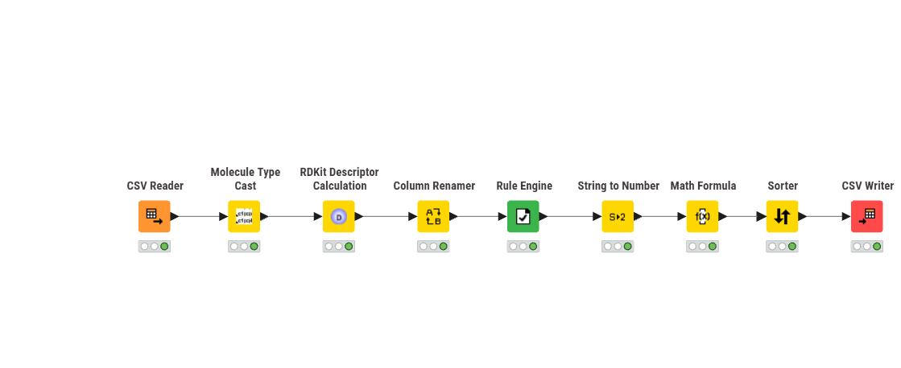

# Beyond Docking Scores: An MPO-Driven Virtual Screening Pipeline, Applied to GPR35

A modular, open-source pipeline for structure-based virtual screening (SBVS) that goes one step past "dock, then filter by Lipinski". It combines docking, interaction analysis, a multi-parameter optimization (MPO) score, ML-accelerated docking and a simple de novo module. I tested it on GPR35, an orphan GPCR linked to inflammation.

This is a working prototype and a learning project. Nothing here has been validated experimentally, and the limitations section at the end says what that means in practice.

---

## 1. Why I built this

Docking scores are a useful first filter, but they are a poor stand-in for real binding affinity, and they say nothing about drug-likeness or ADME. A lot of public workflows stop at "dock, then apply Lipinski". I wanted to see what happens when affinity, physicochemical properties and chemical diversity are ranked together in one scoring step that anyone on a project team can run and inspect.

The question I wanted to explore:

> Can a simple MPO score, built on a validated docking protocol and interaction analysis, give a more useful ranking than docking alone, and can it help prioritize novel chemotypes for a target like GPR35?

Short answer so far: the pipeline runs end to end and the ranking behaves sensibly on a small set of known ligands. A proper test against actives and decoys is still to do (see section 6).

---

## 2. What the pipeline does

| Step | Tool | What it's for |
|---|---|---|
| Protein and ligand preparation | RDKit, Meeko | Standardize molecules, generate 3D structures, prepare docking inputs |
| Docking | AutoDock Vina | Pose and affinity prediction |
| Interaction analysis | ProLIF | Which residues the ligand actually contacts |
| Hit selection | RDKit | Lipinski, ADMET-style filters, diversity |
| MPO scoring | Python and KNIME | Composite score: 70% docking affinity, 30% property/ADME penalty |
| ML-accelerated docking | scikit-learn (Random Forest) | Dock a subset, predict the rest, iterate |
| De novo design | RDKit (BRICS) | Fragment top hits and recombine them into new molecules |
| Dynamics | GROMACS | Short MD runs on the protein model |

---

## 3. Making sure the docking can be trusted

Before touching GPR35, I checked that the protocol recovers known results.

**Lysozyme (PDB 1HEW).** Docking NAG gave −6.5 kcal/mol, inside the experimental range I was comparing against (−5 to −7).

**β2-adrenergic receptor (PDB 2RH1).** Redocking carazolol gave −10.04 kcal/mol and an RMSD of 1.74 Å against the crystal pose. That is a reasonable result for a GPCR, though above the 1.5 Å that I would call a tight match.

**Does the ML step save time?** I ran a Random Forest active-learning loop on 2,020 compounds (a ZINC sample plus 20 known β2AR ligands). Docking only 600 of them gave a 3.37× speed-up. In the first iteration the model had a cross-validated R² of 0.56 ± 0.15 (RMSE 1.13 ± 0.25). By iterations 3 and 4, as the library narrowed, R² dropped to roughly zero. This is expected, because the remaining compounds are very similar to each other and the model has little to discriminate on. It does mean the speed-up is real but the model needs retraining or a different strategy once the candidate pool gets narrow. I have only tested at the 2,000-compound scale.

---

## 4. Application: GPR35

### 4.1 Why GPR35

GPR35 is an orphan GPCR implicated in immune regulation and inflammatory bowel disease, and no small-molecule drug targets it yet. It is a useful test case because known agonists exist (so I can check the pipeline against something real) and the biology links to inflammation.

### 4.2 Redocking the crystal ligand

I used the GPR35–lodoxamide structure (PDB 8H8J). Redocking lodoxamide gave an RMSD of 1.36 Å and an affinity of −7.74 kcal/mol. ProLIF found contacts with ARG100, PHE163 and TYR259, which fits what is known about GPR35 SAR.

### 4.3 Ranking known agonists with the MPO score

I docked a small library of known GPR35 agonists and decoys and ranked them with the MPO score.

| Rank | Ligand | Docking (kcal/mol) | MW | LogP | TPSA | MPO |
|---|---|---|---|---|---|---|
| 1 | Lodoxamide | −8.77 | 240.3 | 2.04 | 72.2 | 0.828 |
| 2 | Kynurenic acid | −8.41 | 237.3 | 3.33 | 42.2 | 0.777 |
| 3 | Benzanilide | −7.77 | 197.2 | 2.94 | 29.1 | 0.688 |

Lodoxamide and kynurenic acid come out on top, and decoys such as salicylic acid score poorly. This is encouraging but it is only a sanity check on a handful of molecules. It does not show that MPO ranks better than docking alone. Note that lodoxamide scores −7.74 in the redocking run (4.2) and −8.77 here, so the two runs are not identical, and I'd want to pin down why before comparing numbers across them.

### 4.4 Short MD run on the AlphaFold model

I ran a 0.5 ns simulation in explicit water on the AlphaFold GPR35 model, with RMSD, RMSF, radius of gyration and hydrogen bond analysis.


The backbone RMSD and radius of gyration stayed stable. To be clear about what this is: 0.5 ns is a setup and sanity check, not a stability result. It shows the system is built correctly and doesn't blow up. A meaningful test would need much longer runs with a ligand bound.

### 4.5 De novo design with BRICS

I fragmented the two seed molecules (lodoxamide and kynurenic acid) with BRICS and recombined the fragments into 20 new molecules, then docked and scored them. Eight are in `denovo_results.csv`.

| Ligand | Docking (kcal/mol) | LE* | MW | LogP | MPO | Flags |
|---|---|---|---|---|---|---|
| DeNovo_20 | −10.57 | 0.44 | 308.4 | 5.57 | 0.707 | LogP > 5 |
| DeNovo_19 | −10.56 | 0.48 | 287.3 | 5.44 | 0.706 | LogP > 5 |
| DeNovo_7 | −9.05 | 0.38 | 318.3 | 4.42 | 0.705 | two carboxylic acids |
| DeNovo_12 | −8.85 | 0.37 | 320.3 | 4.84 | 0.685 | two nitro groups |
| DeNovo_15 | −8.64 | 0.36 | 320.3 | 4.84 | 0.664 | two nitro groups |
| DeNovo_18 | −10.01 | 0.50 | 266.3 | 5.30 | 0.651 | LogP > 5 |
| DeNovo_16 | −8.32 | 0.52 | 211.2 | 3.77 | 0.632 | none |
| DeNovo_3 | −8.20 | 0.55 | 193.2 | 3.63 | 0.620 | none |

*LE = ligand efficiency, −docking score divided by the number of heavy atoms (kcal/mol per heavy atom).

What I take from this, without overselling it:

- **Several de novo molecules dock better than lodoxamide (−8.77),** with the two best around −10.6. But Vina tends to reward larger, flatter, more lipophilic molecules, so a better score here is not evidence of better binding. The MPO score agrees: it ranks lodoxamide (0.828) above all of them.
- **The top hits are very lipophilic** (LogP above 5) and DeNovo_20 is a bis-indole. Indoles are common in anti-inflammatory and GPCR chemistry, but that is a general observation, not evidence for this particular molecule.
- **Two of the molecules contain nitro groups,** which would be a safety flag for a cosmetic ingredient, and the two smallest molecules have the best ligand efficiency.
- **The MPO scores are tightly bunched** (0.62 to 0.71), so differences like 0.707 vs 0.705 mean nothing. The ranking is a rough guide, not a verdict.
- I have not yet checked whether these molecules keep the contacts that known GPR35 agonists use (such as ARG100), or whether they are novel compared with known GPR35 ligands in ChEMBL.

So the de novo module works as a mechanism for generating and scoring candidates. I would not call any of these molecules a hit yet.

---

## 5. A KNIME version for non-coders

The core of this project is in Python, but I also rebuilt the MPO scoring and Lipinski filtering as a KNIME workflow (`knime/GPR35_MPO_Scoring.knwf`).



My reasoning: a model is only useful if the people around you can use it. A medicinal chemist or a biologist can drop in a CSV of docking results and get back a ranked list without opening a terminal. It also makes the science easier to audit, because anyone can open the Rule Engine node and see exactly how the Lipinski penalty is applied. It turns what would otherwise be a manual Excel filtering step into something transparent and repeatable.

---

## 6. Limitations and what I would do next

**Limitations**

- No experimental validation of any kind.
- Docking scores come from Vina only, which is fast but crude. Pose quality and scoring are not reliable enough to rank closely related molecules.
- The MPO weights (70/30) were chosen by me, not fitted to data.
- The GPR35 model for MD is an AlphaFold prediction, and the run is very short.
- The benchmarks are small: three known ligands in the MPO table, 2,020 compounds for the ML loop and one seed pair for de novo design.
- The BRICS module only recombines fragments of two seed molecules, so the chemical space it explores is narrow.

**Next steps**

1. Test MPO against docking alone using a proper set of actives and decoys, and report ROC AUC and early enrichment.
2. Re-score the de novo hits with ligand efficiency, structural alerts, an acid/contact check and a novelty search against ChEMBL.
3. Add topical-relevant terms to the MPO (TPSA, safety alerts, synthetic accessibility) so it better fits skin and hair applications.
4. Run the pipeline on a skin, hair or inflammation-related target besides GPR35.
5. Scale the ML docking step to a much larger library and test how to keep it useful when the candidate pool narrows.
6. Extend the MD to tens of nanoseconds with a bound ligand.

---

## 7. Installation and reproducibility

Requires Linux (Ubuntu 20.04+ or WSL2) and Miniconda.

```bash
git clone https://github.com/noor-chemoinformatics/computational-drug-discovery-pipeline.git
cd computational-drug-discovery-pipeline
conda env create -f environment.yml
conda activate cddp
python -c "import numpy, pandas, rdkit, sklearn, prolif, meeko; print('All packages OK')"
vina --version
```

---

## 8. Author

**Manahil Noor**, Master 2 student, cheminformatics
manahilnoor339@gmail.com
GitHub: https://github.com/noor-chemoinformatics

## License

MIT License. See `LICENSE` for details.
